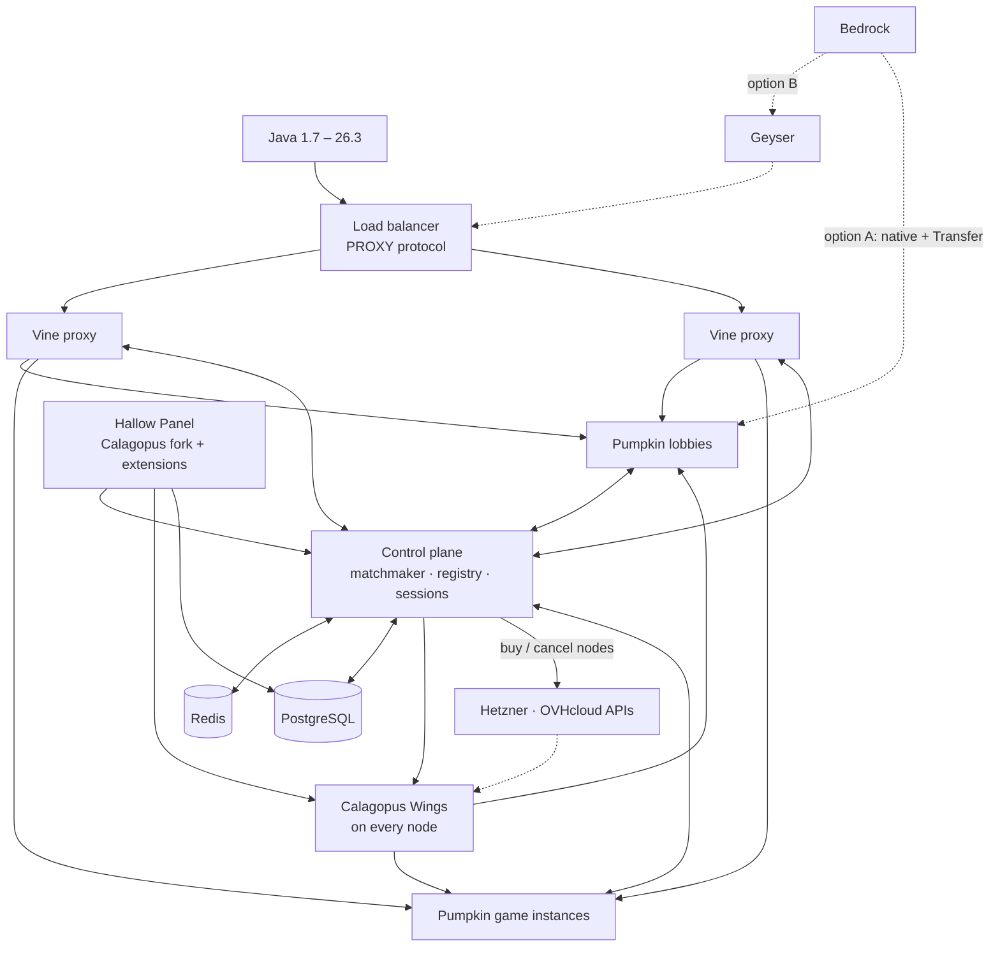

# Hallow

**A full minigame network, built on [Pumpkin](https://github.com/Pumpkin-MC/Pumpkin).** Lobbies, matchmaking, parties, multiple proxies, machines bought and returned on demand from Hetzner and OVHcloud, one panel for every node, server, player and ban. Java 1.7 to 26.3 and Bedrock, written in Rust.

Hallow is a Xena Studios project. It exists to show that Pumpkin and its ecosystem can run a large-network setup, not just a single server, and to send what we build back upstream.

> **Status:** planning. Nothing here runs yet. The first step is [Phase 0](docs/ROADMAP.md#phase-0-validation-spike), a two-week spike that proves old clients, Bedrock and server switching work on the stack before any game is written.

## How it fits together

Old Java clients are translated on each backend by [pumpkin-java-multiversion](https://github.com/Pumpkin-MC/pumpkin-java-multiversion). Vine instances share state through the control plane and Redis, so any number of proxies act as one network. The fleet manager adds hourly cloud machines for peaks and returns them when load drops, down to a single machine when nobody is online, all within a set budget. The full picture is in [Architecture](docs/ARCHITECTURE.md).

## Stack

| Layer | Choice | Language |
|---|---|---|
| Game servers | [Pumpkin](https://github.com/Pumpkin-MC/Pumpkin) | Rust |
| Old Java clients | [pumpkin-java-multiversion](https://github.com/Pumpkin-MC/pumpkin-java-multiversion) | Rust → WASM |
| Bedrock | Pumpkin native, or [Geyser](https://geysermc.org) (decided in Phase 0) | Rust / Java |
| Proxy | [Vine](https://github.com/Pumpkin-MC/Vine), forked for a runtime server registry | Rust |
| Proxy plugins | presence, parties, queues, cross-proxy commands | Rust → WASM |
| Servers | Every lobby and game is a server repo (`hub`, `skywars-lobby`, `skywars`, …) built into an image on Hallow's Pumpkin base image | Rust → WASM |
| SDK | `hallow-sdk`: minigame library and control-plane client for server repos | Rust → WASM |
| Control plane | matchmaker, registry, sessions, orchestration | Rust (tokio, tonic) |
| Node agent | [Calagopus Wings](https://github.com/calagopus/wings) + Docker | Rust |
| Fleet | Fleet manager in the control plane; Hetzner Cloud, Hetzner Robot, OVHcloud provider crates; cloud-init; WireGuard | Rust |
| Panel | [Calagopus Panel](https://github.com/calagopus/panel) fork + extensions | Rust (Axum) + React |
| Data | Redis (live state), PostgreSQL (accounts, ranks, stats, bans) | |
| Monitoring | Prometheus, Grafana, Loki | |

## Repository layout

| Path | What goes there |
|---|---|
| [`upstream/`](upstream/) | Pumpkin, Vine, multiversion and Wings as pinned git submodules |
| [`panel/`](panel/) | The Hallow Panel: the Calagopus Panel fork and its extensions |
| [`crates/`](crates/) | Our Cargo workspace: control plane, shared protocol, Vine plugins, minigame library, games |
| [`web/`](web/) | The player website |
| [`templates/`](templates/) | The server base image and `hallow.toml` format; each lobby and game lives in its own server repo |
| [`deploy/`](deploy/) | Docker Compose for a full local network, production configs |

## Documentation

- [Architecture](docs/ARCHITECTURE.md): every component and how players move through the network
- [Multi-proxy](docs/MULTI-PROXY.md): how several Vine proxies act as one
- [Fleet](docs/FLEET.md): buying, setting up and returning machines on demand
- [Servers](docs/SERVERS.md): proxies and servers, and how lobbies and games are built from their own repos
- [Panel](docs/PANEL.md): one panel for nodes, servers, players, staff and bans
- [Upstream](docs/UPSTREAM.md): what Pumpkin, Vine, multiversion and Calagopus do today, from their source
- [Roadmap](docs/ROADMAP.md): phases, gates and every task
- [Validation](docs/VALIDATION.md): the Phase 0 test matrix
- [Risks](docs/RISKS.md): what could go wrong and the fallback for each
- [Decisions](docs/DECISIONS.md): every locked decision and why
- [Anticheat](docs/ANTICHEAT.md): where checks run, how verdicts are made, and when each part lands
- [Alternatives](docs/ALTERNATIVES.md): other servers, proxies and panels, and why Hallow stays on Pumpkin and Vine

## Contributing

Issues and pull requests are welcome. Start with the [roadmap](docs/ROADMAP.md) and the [open issues](https://github.com/xena-studios/hallow/issues). The org-wide [contributing guide](https://github.com/xena-studios/.github/blob/main/CONTRIBUTING.md), [code of conduct](https://github.com/xena-studios/.github/blob/main/CODE_OF_CONDUCT.md) and [security policy](https://github.com/xena-studios/.github/blob/main/SECURITY.md) apply.

## License

Hallow is licensed under the [GNU Affero General Public License v3.0](LICENSE). Upstream projects keep their own licences: Pumpkin and Vine (GPL-3.0), multiversion (MIT or Apache-2.0, per its `Cargo.toml`), Calagopus Panel and Wings (MIT), Geyser (MIT).
