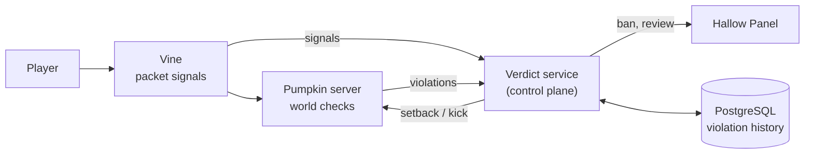

# Anticheat

Hallow builds its own anticheat: none exists for Pumpkin, and Java ones can't run on it. It is designed now, because where checks run and what data they need shape the proxy, the server plugin and the control plane being built in Phase 1.

## Where each check runs

| Layer | Sees | Checks |
|---|---|---|
| **Vine** (proxy) | Every packet from every player, in order, with timing; the player across every server they visit | Click and attack rate, rotation patterns (aim assist), packet order and rate, timer abuse, protocol violations, bad client brands |
| **Pumpkin** (server, Hallow server plugin) | The world: blocks, entities, hitboxes, the player's state | Reach, hit angle, movement against terrain (speed, fly, step, phase), no-fall, scaffold and fast-place, inventory abuse |
| **Verdict service** (control plane) | Violations from every proxy and server, and each player's history | Scores and decays violations per player and check, decides setback, kick, temporary ban or staff review; one place to tune thresholds |

Checks report **violations with evidence**, not bans. The verdict service decides, so thresholds are tuned in one place and every action has a reason staff can review in the panel.

## Constraints from Phase 0

- **Movement is client-authoritative in Pumpkin.** Its own notes say so: the server accepts the client's position. Nothing validates movement today, so the movement checks are ours. Server-side movement validation in Pumpkin itself is a contribution worth offering.
- **No per-packet plugin calls.** A WASM call per packet froze or slowed the server in our load test (Pumpkin-MC/Pumpkin#4583), and `PacketReceivedEvent` uses the same blocking path. Server checks use higher-level events (move, attack, interact, block place) and batch work per tick; packet-level checks live in Vine as native code, not plugin calls.
- **Setbacks need teleports.** Rubber-banding a cheater is a teleport; Pumpkin kicking on stale teleport confirmations (fixed upstream in Pumpkin-MC/Pumpkin#4540) would turn setbacks into kicks.
- **Old clients.** Vine translates old clients to 26.3 (Decisions 29), so checks run on 26.3 packets, but they must know the real client version: 1.8 and 26.3 differ in combat (no attack cooldown), movement and reach.
- **Cost.** Checks run on every player all the time, so they're budgeted like any other tick work and load-tested with the same bots.

## Testing

`netcheck` grows cheating bots: speed, fly, reach, auto-clicker, timer. A suite in CI runs them against the dev network and fails if a check stops catching its cheat, or if honest bots get flagged. Real gameplay recordings from the closed beta become the false-positive set.

## Phases

| Phase | Work |
|---|---|
| 1 | Signal collection: Vine and the server plugin record per-player timing, movement and combat data to the verdict service; no actions yet. Gives real data before thresholds are set |
| 2 | Core checks (movement, reach, click rate, timer) in observe-only mode during the closed beta; cheat bots in CI; panel review page |
| 3 | Actions on (setbacks, kicks, bans with review), tuning from beta data, more checks |
