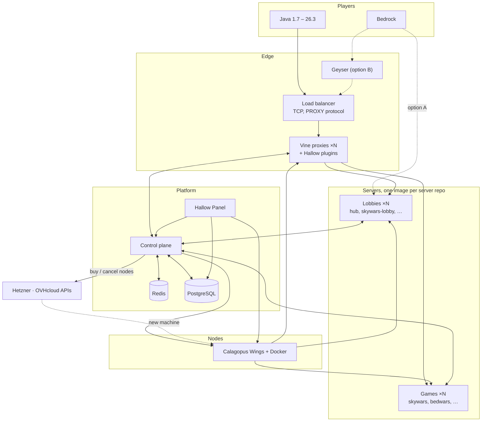

# Architecture

Hallow runs two kinds of process: **proxies** (Vine) and **servers** (Pumpkin). Players reach a load balancer, which spreads them over the proxies; proxies route them to servers; a control plane creates, routes and removes both on nodes run by Calagopus Wings. Every lobby and game is a server built from its own git repo ([Servers](SERVERS.md)). One panel manages everything.

## Components

| Component | Job | Built from | Path |
|---|---|---|---|
| Load balancer | Spreads TCP connections over healthy proxies, passes the real IP with PROXY protocol | HAProxy or a DDoS-protection provider | `deploy/` |
| Vine proxy | Mojang auth, forwarding to backends, server switching, translating Java 1.7 – 26.2 clients to 26.3 | Vine fork, with pumpkin-java-multiversion's translation linked in | `upstream/Vine`, `upstream/pumpkin-java-multiversion` |
| Hallow Vine plugin | Presence, global player count, duplicate-login check, server-list sync, cross-proxy commands; parties and queues later | Ours, WASM | `crates/vine-plugin` |
| Server base image | Pumpkin and Hallow's server plugin; every server image builds on it | Pumpkin + ours | `templates/` |
| Server repos | One per lobby or game (`hub`, `skywars-lobby`, `skywars`, …): plugin, maps, config, `hallow.toml` | Ours, one repo each | separate repos |
| SDK | Minigame library (arenas, teams, kits, scoreboards, spectating, stats, optional 1.8 combat) and control-plane client for server repos | Ours, WASM | `crates/hallow-sdk` |
| Control plane | Server registry, matchmaker, instance orchestration, sessions, proxy sync | Ours, Rust | `crates/control-plane` |
| Protocol | HTTP/JSON API types shared by the control plane and every plugin | Ours, Rust (serde) | `crates/proto` |
| Node agent | Creates, starts, stops and deletes server containers from templates | Calagopus Wings | `upstream/wings` |
| Fleet manager | Buys machines from providers when capacity runs low, sets them up, drains and cancels them when it doesn't | Ours, part of the control plane | `crates/control-plane`, `crates/providers/*` |
| Hallow Panel | One panel for nodes, servers, players, staff, bans, games and stats | Calagopus Panel fork + extensions | `panel/` |
| Redis | Live state: presence, queues, server list, pub/sub between proxies | | |
| PostgreSQL | Accounts, ranks, stats, punishments, panel data | | |
| Player website | Stats, leaderboards, store | Ours, TypeScript | `web/` |
| Monitoring | Metrics, logs, alerts | Prometheus, Grafana, Loki | `deploy/` |

## A player's path

1. The client connects to the load balancer, which picks a healthy Vine proxy.
2. Vine authenticates with Mojang. The presence plugin asks the control plane whether the player is already online on another proxy and refuses the duplicate.
3. Vine sends the player to a `hub` instance the control plane picked, with signed (Ed25519) forwarding.
4. For any client older than 26.3, Vine translates every packet both ways, so the lobby sees a 26.3 client. Switching servers on a client before 1.20.2 is a new join packet and a respawn instead of the configuration phase.
5. The player moves to a gamemode lobby such as `skywars-lobby` and queues. The queue plugin hands the entry to the control plane.
6. The matchmaker fills a game: it uses a warm instance or asks Wings to start one from the game's image, registers it with every Vine, then tells the player's proxy to move them.
7. When the game ends the instance reports results, players go back to the lobby named in its `hallow.toml`, and the instance is deleted. The next match gets a fresh one.

## Bedrock

Since Bedrock 26.60 (27 October 2026) clients connect over **NetherNet**, not RakNet: the client first asks the server how to connect over HTTP(S) on TCP ("signaling"), then plays over WebRTC on UDP. A good implementation multiplexes every player on one UDP port. Plain-HTTP signaling shows players a "Trust on First Use?" prompt; HTTPS needs a domain and a certificate.

**Launch route: Geyser in front of Vine** ([Decisions](DECISIONS.md) 4). Geyser (2.12.1 build 1273 or newer, NetherNet) turns Bedrock players into Java players before Vine, so there is one routing path, one multi-proxy setup and one anticheat for everyone, and only proxies are public. Geyser normally hands Bedrock identities to the proxy through Floodgate, a Java plugin Vine can't run, so Vine verifies Floodgate's encrypted handoff natively (a contribution to Vine).

How the handoff works in Vine (`[floodgate]` in `vine.toml`):

- Geyser puts Floodgate's data in the handshake's server address: AES-128-GCM with a key shared by Geyser and every proxy.
- Vine takes it out of the address before routing, decrypts and checks it, and refuses the login if it's invalid. Geyser joins a listener of its own, where a login without a handoff is refused too.
- The player gets Floodgate's Java identity: `.` + gamertag, UUID `0-0-xuid`, and their own IP. Vine forwards these to servers like any Java player's, so servers and the control plane need nothing extra.
- Plugins can ask whether a player is on Bedrock (`get-bedrock-info`: xuid, device, game version).

**Long-term: Vine speaks Bedrock itself**, terminating NetherNet with Pumpkin's own crates and relaying Bedrock to Pumpkin's Bedrock support. All Rust, and it shows off Pumpkin's Bedrock work, once that work is further along.

**Not used: Bedrock players straight to each Pumpkin server.** Every server would need public TCP and UDP and its own TLS certificate, and players would move between servers with Bedrock's transfer packet.

Vine's Bedrock listener answers RakNet pings (`src/bedrock/listener.rs`), which current clients no longer send.

## Who owns what

- **The control plane** owns every proxy and server instance: it creates them through Wings, scales them per server kind, and deletes them. The panel shows them all live, with consoles and logs through Wings, but never keeps one panel record per instance: each node's Wings uses the control plane as its remote, which answers for the instances it made and passes everything else to the panel. See [Instances](INSTANCES.md).
- **Docker Compose on the floor node** runs the platform services: PostgreSQL, Redis, the control plane, the panel and the load balancer.
- **Server repos** own what a server kind is. Deploying is choosing which image version is live; see [Servers](SERVERS.md#from-repo-to-running-server).

## Fleet

Nodes come in two kinds: monthly dedicated machines for base load and hourly cloud machines for peaks. The fleet manager watches free game slots and queue times, buys burst nodes from Hetzner Cloud or OVHcloud Public Cloud when capacity runs low, sets them up with cloud-init (Docker, Wings, private network), and drains and cancels them when load drops. Monthly orders need staff approval. See [Fleet](FLEET.md).

## Multi-proxy

Every proxy is stateless apart from its connections. Presence, counts, the server list and cross-proxy commands go through the control plane and Redis. See [Multi-proxy](MULTI-PROXY.md).
