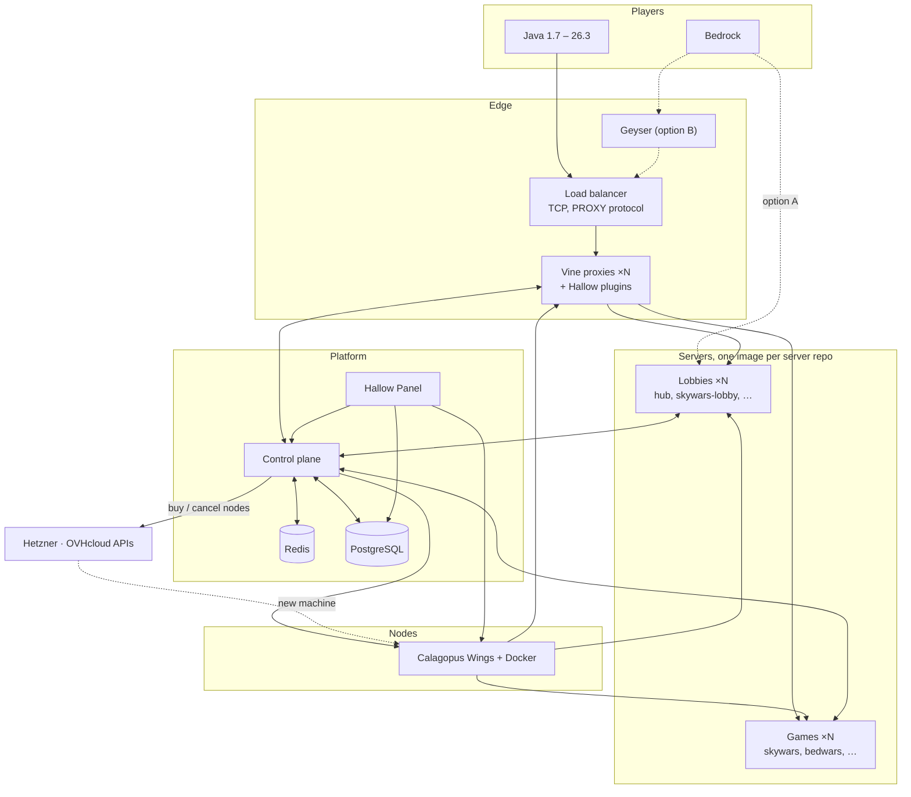

# Architecture

Hallow runs two kinds of process: **proxies** (Vine) and **servers** (Pumpkin). Players reach a load balancer, which spreads them over the proxies; proxies route them to servers; a control plane creates, routes and removes both on nodes run by Calagopus Wings. Every lobby and game is a server built from its own git repo ([Servers](SERVERS.md)). One panel manages everything.

## Components

| Component | Job | Built from | Path |
|---|---|---|---|
| Load balancer | Spreads TCP connections over healthy proxies, passes the real IP with PROXY protocol | HAProxy or a DDoS-protection provider | `deploy/` |
| Vine proxy | Mojang auth, forwarding to backends, server switching | Vine fork | `upstream/Vine` |
| Hallow Vine plugins | Presence, global player count, duplicate-login check, parties, queues, cross-proxy commands | Ours, WASM | `crates/vine-plugins` |
| Server base image | Pumpkin, the multiversion plugin and Hallow's server plugin; every server image builds on it | Pumpkin + ours | `templates/` |
| Multiversion plugin | Translates Java 1.7 – 26.2 clients to 26.3 on each server | pumpkin-java-multiversion | `upstream/pumpkin-java-multiversion` |
| Server repos | One per lobby or game (`hub`, `skywars-lobby`, `skywars`, …): plugin, maps, config, `hallow.toml` | Ours, one repo each | separate repos |
| SDK | Minigame library (arenas, teams, kits, scoreboards, spectating, stats, optional 1.8 combat) and control-plane client for server repos | Ours, WASM | `crates/hallow-sdk` |
| Control plane | Server registry, matchmaker, instance orchestration, sessions, proxy sync | Ours, Rust | `crates/control-plane` |
| Protocol | gRPC types shared by the control plane and every plugin | Ours, protobuf | `crates/proto` |
| Node agent | Creates, starts, stops and deletes server containers from templates | Calagopus Wings | `upstream/wings` |
| Fleet manager | Buys machines from providers when capacity runs low, sets them up, drains and cancels them when it doesn't | Ours, part of the control plane | `crates/control-plane`, `crates/providers/*` |
| Hallow Panel | One panel for nodes, servers, players, staff, bans, games and stats | Calagopus Panel fork + extensions | `panel/` |
| Redis | Live state: presence, queues, server list, pub/sub between proxies | | |
| PostgreSQL | Accounts, ranks, stats, punishments, panel data | | |
| Player website | Stats, leaderboards, store | Ours, TypeScript | `web/` |
| Monitoring | Metrics, logs, alerts | Prometheus, Grafana, Loki | `deploy/` |

## A player's path

1. The client connects to the load balancer, which picks a healthy Vine proxy.
2. Vine authenticates with Mojang. The presence plugin asks the control plane whether the player is already online on another proxy and refuses the duplicate.
3. Vine sends the player to a `hub` instance the control plane picked, with signed (Ed25519) forwarding.
4. For any client older than 26.3, the multiversion plugin on the lobby translates every packet both ways.
5. The player moves to a gamemode lobby such as `skywars-lobby` and queues. The queue plugin hands the entry to the control plane.
6. The matchmaker fills a game: it uses a warm instance or asks Wings to start one from the game's image, registers it with every Vine, then tells the player's proxy to move them.
7. When the game ends the instance reports results, players go back to the lobby named in its `hallow.toml`, and the instance is deleted. The next match gets a fresh one.

## Bedrock

Two routes; [Phase 0](ROADMAP.md#phase-0-validation-spike) picks one.

- **A, native:** Bedrock players connect straight to a Pumpkin backend with its built-in Bedrock listener and Xbox auth. They move between backends with Bedrock's Transfer packet, coordinated by the control plane. Every backend needs a public UDP port, and these players never pass through Vine.
- **B, Geyser:** Geyser instances behind a UDP load balancer turn Bedrock into Java before Vine. One routing path for everyone, at the cost of a Java dependency.

Vine's Bedrock listener only answers server-list pings today (`src/bedrock/listener.rs`), so it does not carry Bedrock play traffic for either route.

## Who owns what

- **The control plane** owns every proxy and server instance: it creates them through Wings, scales them per server kind, and deletes them. The panel shows them all live, with consoles and logs through Wings, but never keeps one panel record per instance.
- **Docker Compose on the floor node** runs the platform services: PostgreSQL, Redis, the control plane, the panel and the load balancer.
- **Server repos** own what a server kind is. Deploying is choosing which image version is live; see [Servers](SERVERS.md#from-repo-to-running-server).

## Fleet

Nodes come in two kinds: monthly dedicated machines for base load and hourly cloud machines for peaks. The fleet manager watches free game slots and queue times, buys burst nodes from Hetzner Cloud or OVHcloud Public Cloud when capacity runs low, sets them up with cloud-init (Docker, Wings, private network), and drains and cancels them when load drops. Monthly orders need staff approval. See [Fleet](FLEET.md).

## Multi-proxy

Every proxy is stateless apart from its connections. Presence, counts, the server list and cross-proxy commands go through the control plane and Redis. See [Multi-proxy](MULTI-PROXY.md).
