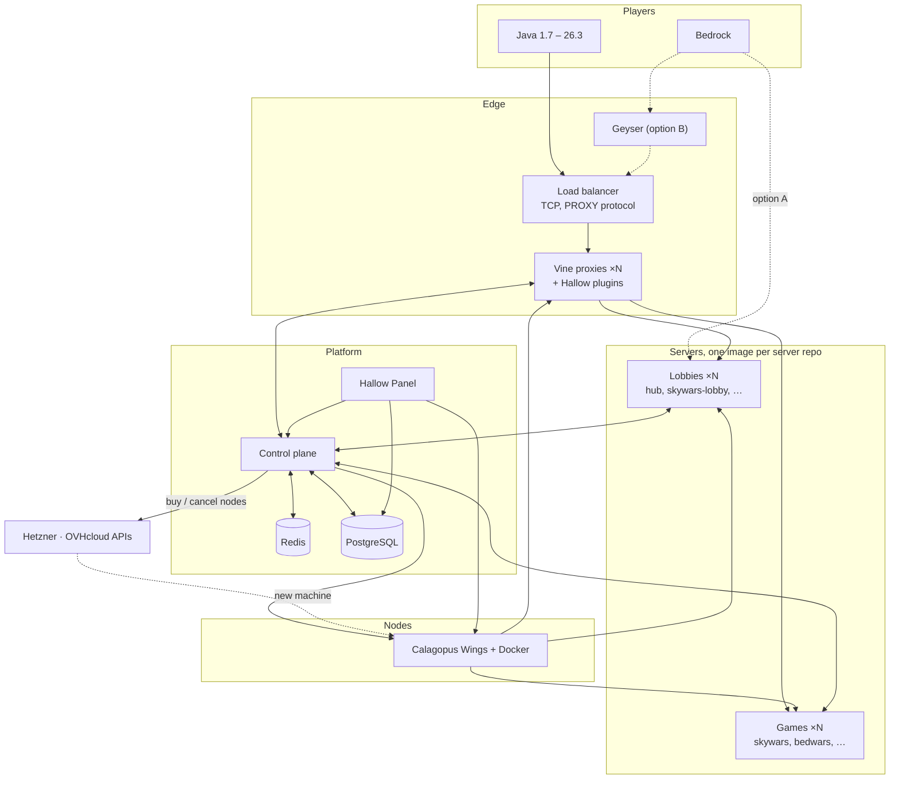

# Architecture

Hallow runs two kinds of process: **proxies** (Vine) and **servers** (Pumpkin). Players reach a load balancer, which spreads them over the proxies; proxies route them to servers; a control plane creates, routes and removes both on nodes run by Calagopus Wings. Every lobby and game is a server built from its own git repo ([Servers](SERVERS.md)). One panel manages everything.

## Components

| Component | Job | Built from | Path |
|---|---|---|---|
| Load balancer | Spreads TCP connections over healthy proxies, passes the real IP with PROXY protocol | HAProxy or a DDoS-protection provider | `deploy/` |
| Vine proxy | Mojang auth, forwarding to backends, server switching, translating Java 1.7 – 26.2 clients to 26.3, a built-in limbo, and moving players to a fallback instead of disconnecting them | Vine fork, with pumpkin-java-multiversion's translation linked in | `upstream/Vine`, `upstream/pumpkin-java-multiversion` |
| Hallow Vine plugin | Presence, global player count, duplicate logins, server-list sync, cross-proxy commands, parties and queues, fallbacks, keeping banned players in the banned lobby | Ours, WASM | `crates/vine-plugin` |
| Banned lobby | Where banned players wait: the ban's reason, issuer, end and appeal | A server repo, like the hub | `servers/banned` |
| Server base image | Pumpkin and Hallow's server plugin; every server image builds on it | Pumpkin + ours | `templates/` |
| Server repos | One per lobby or game (`hub`, `skywars-lobby`, `skywars`, …): plugin, maps, config, `hallow.toml` | Ours, one repo each | separate repos |
| SDK | Minigame library (arenas, teams, kits, scoreboards, spectating, stats, optional 1.8 combat) and control-plane client for server repos | Ours, WASM | `crates/hallow-sdk` |
| Control plane | Server registry, matchmaker, instance orchestration, sessions, proxy sync | Ours, Rust | `crates/control-plane` |
| Protocol | HTTP/JSON API types shared by the control plane and every plugin | Ours, Rust (serde) | `crates/proto` |
| Node agent | Creates, starts, stops and deletes server containers from templates | Calagopus Wings | `upstream/wings` |
| Fleet manager | Buys machines from providers when capacity runs low, sets them up, drains and cancels them when it doesn't | Ours, part of the control plane | `crates/control-plane`, `crates/providers/*` |
| Hallow Panel | One panel for nodes, servers, players, staff, bans, games and stats | Calagopus Panel fork + extensions | `panel/` |
| Redis | Live state: presence, queues, server list, pub/sub between proxies | | |
| PostgreSQL | Accounts, ranks, stats, punishments, panel data | | |
| Player website | Stats, leaderboards, store | Ours, TypeScript | `web/` |
| Monitoring | Metrics, logs, alerts | Prometheus, Grafana, Loki | `deploy/` |

## A player's path

1. The client connects to the load balancer, which picks a healthy Vine proxy.
2. Vine authenticates with Mojang. The presence plugin asks the control plane where the player goes. A login from an account already online replaces the old session.
3. Vine sends the player where the control plane said, with signed (Ed25519) forwarding: a `hub` instance, the banned lobby for a banned player, or limbo to wait when the network is full or no hub is free ([Never dropped](#never-dropped)).
4. For any client older than 26.3, Vine translates every packet both ways, so the lobby sees a 26.3 client. Switching servers on a client before 1.20.2 is a new join packet and a respawn instead of the configuration phase.
5. The player moves to a gamemode lobby such as `skywars-lobby` and queues. The queue plugin hands the entry to the control plane.
6. The matchmaker fills a game: it uses a warm instance or asks Wings to start one from the game's image, registers it with every Vine, then tells the player's proxy to move them.
7. When the game ends the instance reports results, players go back to the lobby named in its `hallow.toml`, and the instance is deleted. The next match gets a fresh one.

## Never dropped

The network never disconnects a player for something it can fix. Every case that used to end the connection puts the player somewhere and tells them why:

| What happens | Where the player goes | Who decides |
|---|---|---|
| A banned player logs in, or is banned while online | The banned lobby (`servers/banned`), or limbo while none is up. They can't leave: `/server` is refused by their proxy, and `/hub`, `/lobby`, `/play`, parties and sends by the control plane. When the ban ends or staff lift it, they go to a hub without reconnecting | Control plane |
| The network is full, or no hub is free | Limbo, with their place in line. They move on by themselves, oldest first, when there's room | Control plane |
| A server kicks them, crashes, stops or is deleted | The game's lobby, another lobby of the same kind, a hub, or limbo, in that order, with a message naming the server and its reason | Control plane, asked by the proxy (`POST /v1/presence/fallback`) |
| A switch to another server fails | They stay where they are, with a message | Vine |
| The first connect fails | The next fallback, then limbo | Vine and the control plane |
| The control plane can't be reached | Limbo, unverified: they can't leave, and the proxy asks again every 2 s, then sends them where the answer says | Vine plugin |
| A staff kick (`/gkick`, the panel) | Limbo for `HALLOW_KICK_HOLD_SECS` (10) with the reason as a title, then a hub | Control plane |
| A second login from the same account | The new session replaces the old one, which is disconnected: one account can only be in one place, and the player is the one who connected again. `HALLOW_DUPLICATE_LOGIN=deny` keeps the old one instead | Control plane |
| A proxy drains | Players on lobbies and in limbo are handed to the load balancer with the Transfer packet (1.20.5 and later), which picks another proxy; players in a game go when they leave it. Older clients have no Transfer packet: they stay until they leave or the proxy stops | Vine plugin (`transfer_to`) |
| A proxy stops | Vine transfers 1.20.5+ clients to `routing.shutdown_transfer`, then disconnects the rest with a message to reconnect | Vine |

**Limbo is answered by Vine itself.** It is a minimal 26.3 server inside the proxy, on a loopback port, registered as the server `limbo` on every proxy: a void, spectator mode, keep-alives, nothing else. No world and no backend connection, so it costs one small task per player, and it is there whenever the proxy is. That is the point: limbo is where players wait exactly when the network can't place them, with the control plane down, no hub up or every server failing, so it can't be a server the network has to start or reach. Old clients reach it through Vine's translation like any server. The plugin shows each limbo player why they wait on their action bar.

**The banned lobby is a Pumpkin server kind.** It is a normal place on a working network, and it needs a world (a closed room) and per-player display: a title, the ban's reason, who issued it as the panel shows them, when it ends with a live countdown, the punishment id and how to appeal (`HALLOW_APPEAL_TEXT`, `HALLOW_APPEAL_URL`). Players are invisible to each other and chat is off. One instance holds 500 players; the control plane starts one when a banned player waits in limbo for it.

**What still disconnects:** the client quitting, a lost network connection, protocol errors, a login racing the same account's other login, and a proxy shutting down (after the transfers above).

## Bedrock

Since Bedrock 26.60 (27 October 2026) clients connect over **NetherNet**, not RakNet: the client first asks the server how to connect over HTTP(S) on TCP ("signaling"), then plays over WebRTC on UDP. A good implementation multiplexes every player on one UDP port. Plain-HTTP signaling shows players a "Trust on First Use?" prompt; HTTPS needs a domain and a certificate.

**Launch route: Geyser in front of Vine** ([Decisions](DECISIONS.md) 4). Geyser (2.12.1 build 1273 or newer, NetherNet) turns Bedrock players into Java players before Vine, so there is one routing path, one multi-proxy setup and one anticheat for everyone, and only proxies are public. Geyser normally hands Bedrock identities to the proxy through Floodgate, a Java plugin Vine can't run, so Vine verifies Floodgate's encrypted handoff natively (a contribution to Vine).

**Long-term: Vine speaks Bedrock itself**, terminating NetherNet with Pumpkin's own crates and relaying Bedrock to Pumpkin's Bedrock support. All Rust, and it shows off Pumpkin's Bedrock work, once that work is further along.

**Not used: Bedrock players straight to each Pumpkin server.** Every server would need public TCP and UDP and its own TLS certificate, and players would move between servers with Bedrock's transfer packet.

Vine's Bedrock listener answers RakNet pings (`src/bedrock/listener.rs`), which current clients no longer send.

## Who owns what

- **The control plane** owns every proxy and server instance: it creates them through Wings, scales them per server kind, and deletes them. The panel shows them all live, with consoles and logs through Wings, but never keeps one panel record per instance: each node's Wings uses the control plane as its remote, which answers for the instances it made and passes everything else to the panel. See [Instances](INSTANCES.md).
- **Docker Compose on the floor node** runs the platform services: PostgreSQL, Redis, the control plane, the panel and the load balancer.
- **Server repos** own what a server kind is. Deploying is choosing which image version is live; see [Servers](SERVERS.md#from-repo-to-running-server).

## Fleet

Nodes come in two kinds: monthly dedicated machines for base load and hourly cloud machines for peaks. The fleet manager watches free game slots and queue times, buys burst nodes from Hetzner Cloud or OVHcloud Public Cloud when capacity runs low, sets them up with cloud-init (Docker, Wings, private network), and drains and cancels them when load drops. Monthly orders need staff approval. See [Fleet](FLEET.md).

## Multi-proxy

Every proxy is stateless apart from its connections. Presence, counts, the server list and cross-proxy commands go through the control plane and Redis. See [Multi-proxy](MULTI-PROXY.md).
