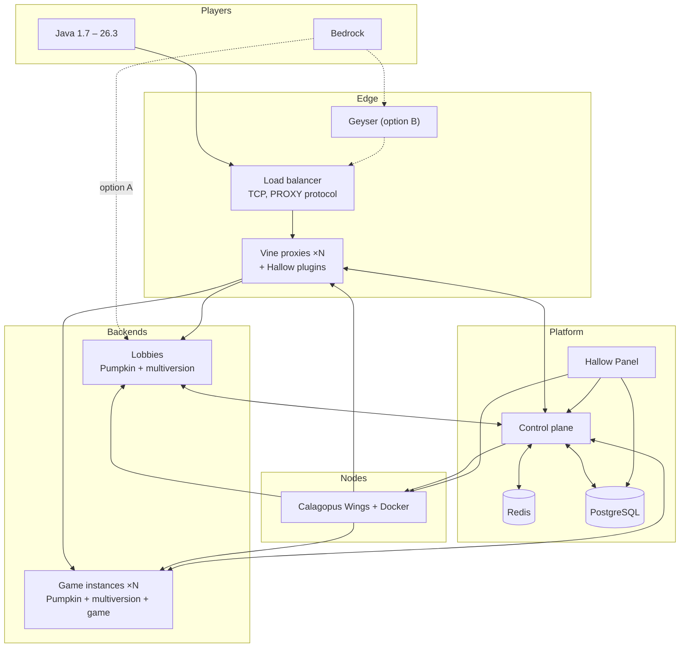

# Architecture

Hallow is five layers: players reach a load balancer, the load balancer spreads them over Vine proxies, proxies route them to Pumpkin backends, and a control plane coordinates all of it on nodes run by Calagopus Wings. One panel manages everything.

## Components

| Component | Job | Built from | Path |
|---|---|---|---|
| Load balancer | Spreads TCP connections over healthy proxies, passes the real IP with PROXY protocol | HAProxy or a DDoS-protection provider | `deploy/` |
| Vine proxy | Mojang auth, forwarding to backends, server switching | Vine fork | `upstream/vine` |
| Hallow Vine plugins | Presence, global player count, duplicate-login check, parties, queues, cross-proxy commands | Ours, WASM | `crates/vine-plugins` |
| Pumpkin backend | Runs a lobby or one game instance | Pumpkin | `upstream/pumpkin` |
| Multiversion plugin | Translates Java 1.7 – 26.2 clients to 26.3 on each backend | pumpkin-java-multiversion | `upstream/multiversion` |
| Minigame library | Arenas, teams, kits, scoreboards, map reset, stats, optional 1.8 combat | Ours, WASM | `crates/minigame-lib` |
| Games | One crate per game | Ours, WASM | `crates/games/*` |
| Control plane | Server registry, matchmaker, instance orchestration, sessions, proxy sync | Ours, Rust | `crates/control-plane` |
| Protocol | gRPC types shared by the control plane and every plugin | Ours, protobuf | `crates/proto` |
| Node agent | Creates, starts, stops and deletes server containers from templates | Calagopus Wings | `upstream/wings` |
| Hallow Panel | One panel for nodes, servers, players, staff, bans, games and stats | Calagopus Panel fork + extensions | `panel/` |
| Redis | Live state: presence, queues, server list, pub/sub between proxies | | |
| PostgreSQL | Accounts, ranks, stats, punishments, panel data | | |
| Player website | Stats, leaderboards, store | Ours, TypeScript | `web/` |
| Monitoring | Metrics, logs, alerts | Prometheus, Grafana, Loki | `deploy/` |

## A player's path

1. The client connects to the load balancer, which picks a healthy Vine proxy.
2. Vine authenticates with Mojang. The presence plugin asks the control plane whether the player is already online on another proxy and refuses the duplicate.
3. Vine sends the player to a lobby the control plane picked, with signed (Ed25519) forwarding.
4. For any client older than 26.3, the multiversion plugin on the lobby translates every packet both ways.
5. The player queues for a game. The queue plugin hands the entry to the control plane.
6. The matchmaker fills a game: it reuses a waiting instance or asks Wings to start one from the game's template, registers it with every Vine, then tells the player's proxy to move them.
7. When the game ends the instance reports results, players go back to a lobby, and the matchmaker deletes or recycles the instance.

## Bedrock

Two routes; [Phase 0](ROADMAP.md#phase-0-validation-spike) picks one.

- **A, native:** Bedrock players connect straight to a Pumpkin backend with its built-in Bedrock listener and Xbox auth. They move between backends with Bedrock's Transfer packet, coordinated by the control plane. Every backend needs a public UDP port, and these players never pass through Vine.
- **B, Geyser:** Geyser instances behind a UDP load balancer turn Bedrock into Java before Vine. One routing path for everyone, at the cost of a Java dependency.

Vine's Bedrock listener only answers server-list pings today (`src/bedrock/listener.rs`), so it does not carry Bedrock play traffic for either route.

## Servers that live and servers that don't

- **Long-lived** (proxies, lobbies, limbo) are normal Calagopus servers. Staff see their consoles, logs and files in the panel.
- **Short-lived** game instances are created and deleted by the matchmaker through the Wings API, never one panel record each. The panel shows them in a live view read from the control plane.

## Multi-proxy

Every proxy is stateless apart from its connections. Presence, counts, the server list and cross-proxy commands go through the control plane and Redis. See [Multi-proxy](MULTI-PROXY.md).
