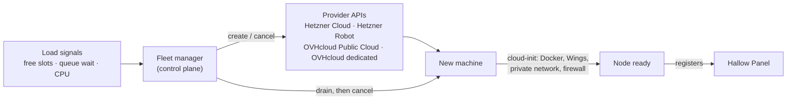

# Fleet

Hallow buys, sets up and returns machines on its own as player load changes, from a single machine when nobody is online up to as many as the budget allows. The fleet manager in the control plane talks to provider APIs (Hetzner and OVHcloud first) to add a node when capacity runs low, installs Wings on it, and drains and cancels it when it is no longer needed.

## From one machine up

With nobody online, the whole network runs on one machine: the **floor node**. Everything else is added as players arrive and removed when they leave.

| Players online | Machines | What runs |
|---|---|---|
| 0 | 1, the floor node | Load balancer, control plane, Redis, PostgreSQL, panel, one Vine, one `hub`. No game or gamemode-lobby instances. |
| A few | 1 | Game instances start on the floor node as players queue. |
| The floor node fills up | 1 + burst nodes | New game instances, then extra lobbies and proxies, go to burst nodes. |
| Peak | Floor + base + burst | Proxies, lobbies and game instances spread over every node. |

Every layer scales on its own signal, down to its minimum:

| Layer | Scales on | Minimum |
|---|---|---|
| Game servers, per kind | Players queued, `warm` in its `hallow.toml` | 0 |
| Lobby servers, per kind | Players per instance (`players.max`) | 1 for `hub`, 0 for gamemode lobbies |
| Proxies | Players and CPU per proxy | 1 |
| Nodes | Free slots left after the layers above | 1, the floor node |

When the last player leaves, games end, warm pools shrink to zero after an idle timeout, extra lobbies and proxies stop, and burst nodes drain and are cancelled. The floor node never stops, so the first player always gets in straight away. The first game after a quiet spell is a cold start on the floor node; Phase 0 measures how long that takes, and a warm pool of one for the most popular game can be kept when the budget allows.

The floor is configurable. One node is the cheapest. Two or more put the platform services (PostgreSQL, Redis, control plane) on separate machines so losing one doesn't take the network down; that's the setting for after launch.

## Budgets

Budgets stop growth; they never cut a node that has players on it.

- **Limits:** a monthly budget and a daily cap for the whole network, and a maximum node count; per-region caps may follow. All are [settings](#settings) set in the panel; every change is in the settings history.
- **Days and months** start at midnight in the network's time zone setting, so the daily cap and the monthly budget line up with the bills.
- **Forecast:** the fleet manager knows the running cost of every node and forecasts month-end spend. As the forecast nears the budget it keeps less spare capacity, then stops buying.
- **At the cap:** no new nodes. The matchmaker packs games tighter, queues get longer, players in a queue see that the network is busy, and staff are alerted. Staff can raise the cap from the panel.
- **The floor node** always counts against the budget and is never cut.

## Two kinds of capacity

| Kind | Providers | Billing | Ready in | Used for |
|---|---|---|---|---|
| **Base** | Hetzner Robot dedicated, OVHcloud dedicated | Monthly | Hours to days | The floor node and the load we always have. Cheapest per core. |
| **Burst** | Hetzner Cloud, OVHcloud Public Cloud | Hourly | Minutes | Peaks: evenings, weekends, events, launches. Returned when the peak ends. |

Burst nodes are added and removed automatically. Base nodes are ordered automatically only when burst capacity has stayed high for a configured time, and only after a staff member approves the order in the panel, because a monthly order can't be undone in an hour.

Provider billing details and delivery times change, so they live in each provider's config, not in code, and Phase 0 checks them.

## Scaling

**Scale up** when either holds for a few minutes:

- free game slots across all nodes, after warm instance pools, drop below the target headroom
- queue wait for any game passes its target

**Scale down** when free capacity stays above the headroom for a while:

1. Pick the node that is cheapest to lose: burst before base, then the fewest players.
2. Mark it draining: the matchmaker stops placing games there.
3. Wait for its games to end, or until a deadline, then move what is left.
4. Delete its servers through Wings, remove it from the panel, cancel it with the provider. A burst node is kept until just before its next billing step when that is cheaper than buying again soon.

Every threshold, wait time and cooldown is a [setting](#settings) in the panel. Per-region values may follow; for now they apply to the whole network.

## Settings

Nothing the fleet manager decides by is hard-coded. Every setting lives in PostgreSQL (`hallow.fleet_settings`, one row), and staff change them from the Fleet page in the panel, which reads and writes them through the control plane:

- `GET /v1/fleet/settings` returns the settings in force with who changed them last and when, or the defaults below if nobody has;
- `PUT /v1/fleet/settings` with `{settings, updated_by}` replaces them. Invalid settings are refused with a `400` whose `fields` says what is wrong with each field, so the form can show it in place;
- every change is kept, with the settings before and after, in `hallow.fleet_settings_history`, read with `GET /v1/fleet/settings/history?limit=` (newest first).

The types are `hallow_proto::fleet::FleetSettings`; `hallow_fleet` turns them into the planner's policy. A setting left out of a `PUT`, or added after the settings were last saved, takes its default.

| Setting | Default | What it does |
|---|---|---|
| `dry_run` | `true` | Log what would be bought and cancelled without calling any provider. |
| `paused` | `false` | Make no decisions at all: nothing is bought, drained or cancelled. |
| `timezone` | `"UTC"` | IANA time zone where "today" (daily cap) and "this month" (budget) start, such as `Europe/Berlin`. |
| `currency` | `"EUR"` | ISO 4217 code of the budgets and provider prices. |
| `monthly_budget` | `"100.00"` | Month-end forecast limit, a decimal amount in `currency`; `null` for no limit. |
| `daily_cap` | `"10.00"` | Spend limit for one day, no more than the monthly budget; `null` for no limit. |
| `max_nodes` | `10` | Nodes of every kind and phase, the floor included; at least `floor_nodes`. |
| `headroom_slots` | `40` | Free game slots to keep across all nodes. |
| `tighten_from` | `0.8` | Fraction of the monthly budget (0 to 1) at which headroom starts shrinking, to zero at the budget. |
| `queue_wait_target_secs` | `60` | Scale up when any queue waits longer than this. |
| `scale_up_after_secs` | `180` | Pressure must hold this long before buying. |
| `scale_down_after_secs` | `600` | Spare capacity must hold this long before draining. |
| `scale_up_cooldown_secs` | `300` | After a buy, no further buy for this long. |
| `scale_down_cooldown_secs` | `900` | After a buy or a drain, no drain for this long. |
| `drain_deadline_secs` | `1200` | A draining node is cancelled after this even with players left (they are moved first). |
| `billing_step_margin_secs` | `300` | An empty hourly node is kept until this long before its next billing step; under an hour. |
| `base_drain_needs_approval` | `true` | Cancelling a draining base node waits for a staff member's approval. |
| `prefer_burst_on_scale_down` | `true` | Drain burst nodes before base nodes. |
| `floor_nodes` | `1` | How many nodes (the oldest base nodes) are never drained or cancelled; at least 1. |
| `providers` | `hetzner-cloud`, enabled, any region and type | Providers to buy from, each `{name, enabled, regions, machine_types}`; an empty list allows any region or type, and an unlisted provider is never used. |

Durations are in seconds, from 0 to 30 days. Provider credentials are never settings; they stay in the secrets store.

## Setting up a new node

1. The fleet manager creates the machine with a cloud-init script (cloud) or an install image and script (dedicated).
2. The script installs Docker and Calagopus Wings, joins the private network (WireGuard across providers; Hetzner vSwitch or OVHcloud vRack inside one), and locks the firewall to game ports and the private network.
3. Wings starts with a one-time join token, and the node registers itself in the panel.
4. The node takes server templates and starts getting games.

The same steps set up a machine staff add by hand.

## Safety

- **Budgets:** see [Budgets](#budgets). The fleet manager refuses to buy past them and alerts.
- **Approval** in the panel for every monthly order and every cancellation of a base node.
- **Cooldowns** between scale actions so a short spike can't loop buy and cancel.
- **Dry run:** log what the fleet manager would do without calling providers. The default until each provider is trusted.
- **Credentials** for provider APIs live in the secrets store, never in config or the panel database. Each provider gets an API key limited to what the fleet manager needs.
- **Audit log:** every order, setup, drain and cancellation shows in the panel with its reason and cost.

## Providers

The fleet manager talks to providers through one Rust trait (`create`, `status`, `cancel`, `list`, `prices`), so a provider is one crate in `crates/providers/`.

| Provider | API | First |
|---|---|---|
| Hetzner Cloud | Hetzner Cloud API | Phase 2 |
| Hetzner Robot (dedicated) | Hetzner Robot API | Phase 3 |
| OVHcloud Public Cloud | OVHcloud API / OpenStack | Phase 3 |
| OVHcloud dedicated | OVHcloud API (order flow) | Phase 3 |

More providers can follow the same trait.

## In the panel

A Fleet page shows every node with its provider, region, kind, cost so far this month, players and state (setting up, ready, draining, cancelled). Staff can add, drain or cancel a node, approve orders, and edit every [setting](#settings): scaling targets, budgets and caps, the time zone, providers, and dry run.
