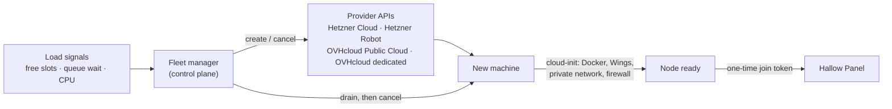
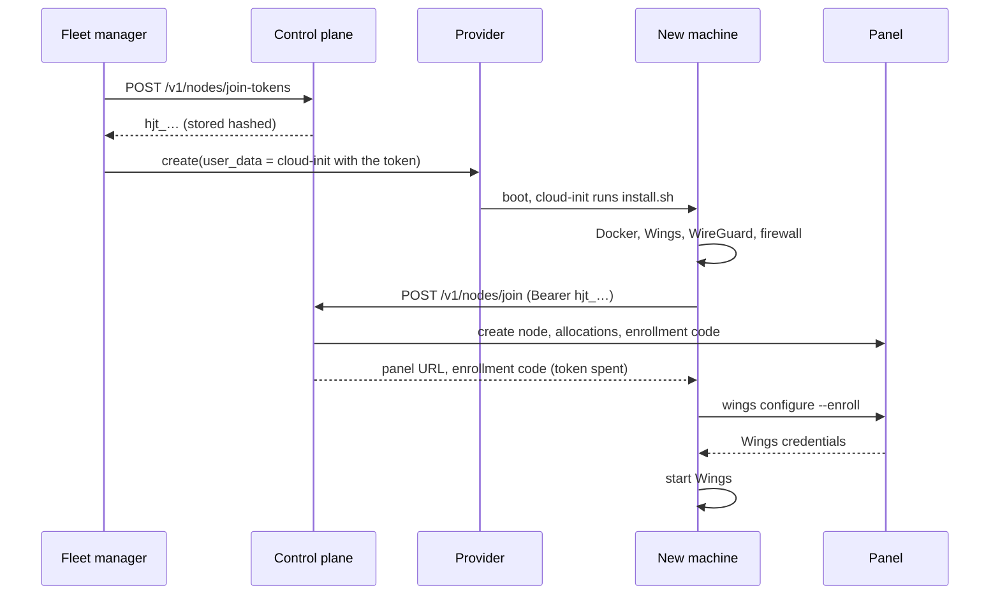

# Fleet

Hallow buys, sets up and returns machines on its own as player load changes, from a single machine when nobody is online up to as many as the budget allows. The fleet manager in the control plane talks to provider APIs (Hetzner and OVHcloud first) to add a node when capacity runs low, installs Wings on it, and drains and cancels it when it is no longer needed.



## From one machine up

With nobody online, the whole network runs on one machine: the **floor node**. Everything else is added as players arrive and removed when they leave.

| Players online | Machines | What runs |
|---|---|---|
| 0 | 1, the floor node | Load balancer, control plane, Redis, PostgreSQL, panel, one Vine, one `hub`. No game or gamemode-lobby instances. |
| A few | 1 | Game instances start on the floor node as players queue. |
| The floor node fills up | 1 + burst nodes | New game instances, then extra lobbies and proxies, go to burst nodes. |
| Peak | Floor + base + burst | Proxies, lobbies and game instances spread over every node. |

Every layer scales on its own signal, down to its minimum:

| Layer | Scales on | Minimum |
|---|---|---|
| Game servers, per kind | Players queued, `warm` in its `hallow.toml` | 0 |
| Lobby servers, per kind | Players per instance (`players.max`) | 1 for `hub`, 0 for gamemode lobbies |
| Proxies | Players per proxy (`players_per_proxy`); CPU to come | `min_proxies`, 1 |
| Nodes | Free slots left after the layers above | 1, the floor node |

Game instances and lobbies are scaled by the instance lifecycle ([Instances](INSTANCES.md)); nodes and proxies by the fleet manager ([below](#the-fleet-manager)). Proxies are drained when the players don't need them and given back as players arrive. Starting a new proxy isn't automatic yet: when the players need more proxies than run, the fleet manager alerts staff.

When the last player leaves, games end, warm pools shrink to zero after an idle timeout, extra lobbies and proxies stop, and burst nodes drain and are cancelled. The floor node never stops, so the first player always gets in straight away. The first game after a quiet spell is a cold start on the floor node; Phase 0 measures how long that takes, and a warm pool of one for the most popular game can be kept when the budget allows.

The floor is configurable. One node is the cheapest. Two or more put the platform services (PostgreSQL, Redis, control plane) on separate machines so losing one doesn't take the network down; that's the setting for after launch.

## Budgets

Budgets stop growth; they never cut a node that has players on it.

- **Limits:** a monthly budget and a daily cap for the whole network, and a maximum node count; per-region caps may follow. All are [settings](#settings) set in the panel; every change is in the settings history.
- **Days and months** start at midnight in the network's time zone setting, so the daily cap and the monthly budget line up with the bills.
- **Forecast:** the fleet manager knows the running cost of every node and forecasts month-end spend. As the forecast nears the budget it keeps less spare capacity, then stops buying.
- **At the cap:** no new nodes. The matchmaker packs games tighter (it always fills the fullest game first, and no node takes more instances than its slots), queues get longer, players in a queue are told the network is busy, and staff are alerted. Staff can raise the cap from the panel. See [At the cap](#at-the-cap).
- **The floor node** always counts against the budget and is never cut.

## Two kinds of capacity

| Kind | Providers | Billing | Ready in | Used for |
|---|---|---|---|---|
| **Base** | Hetzner Robot dedicated, OVHcloud dedicated | Monthly | Hours to days | The floor node and the load we always have. Cheapest per core. |
| **Burst** | Hetzner Cloud, OVHcloud Public Cloud | Hourly | Minutes | Peaks: evenings, weekends, events, launches. Returned when the peak ends. |

Burst nodes are added and removed automatically. Base nodes are ordered automatically only when burst capacity has stayed high for a configured time, and only after a staff member approves the order in the panel, because a monthly order can't be undone in an hour.

Provider billing details and delivery times change, so they live in each provider's config, not in code, and Phase 0 checks them.

## Scaling

**Scale up** when either holds for a few minutes:

- free game slots across all nodes, after warm instance pools, drop below the target headroom
- queue wait for any game passes its target

**Scale down** when free capacity stays above the headroom for a while:

1. Pick the node that is cheapest to lose: burst before base, then the fewest players.
2. Mark it draining: the matchmaker stops placing games there.
3. Wait for its games to end, or until a deadline, then move what is left.
4. Delete its servers through Wings, remove it from the panel, cancel it with the provider. A burst node is kept until just before its next billing step when that is cheaper than buying again soon.

Every threshold, wait time and cooldown is a [setting](#settings) in the panel. Per-region values may follow; for now they apply to the whole network.

## Settings

Nothing the fleet manager decides by is hard-coded. Every setting lives in PostgreSQL (`hallow.fleet_settings`, one row), and staff change them from the Fleet page in the panel, which reads and writes them through the control plane:

- `GET /v1/fleet/settings` returns the settings in force with who changed them last and when, or the defaults below if nobody has;
- `PUT /v1/fleet/settings` with `{settings, updated_by}` replaces them. Invalid settings are refused with a `400` whose `fields` says what is wrong with each field, so the form can show it in place;
- every change is kept, with the settings before and after, in `hallow.fleet_settings_history`, read with `GET /v1/fleet/settings/history?limit=` (newest first).

The types are `hallow_proto::fleet::FleetSettings`; `hallow_fleet` turns them into the planner's policy. A setting left out of a `PUT`, or added after the settings were last saved, takes its default.

| Setting | Default | What it does |
|---|---|---|
| `dry_run` | `true` | Log what would be bought and cancelled without calling any provider. |
| `paused` | `false` | Make no decisions at all: nothing is bought, drained or cancelled. |
| `timezone` | `"UTC"` | IANA time zone where "today" (daily cap) and "this month" (budget) start, such as `Europe/Berlin`. |
| `currency` | `"EUR"` | ISO 4217 code of the budgets and provider prices. |
| `monthly_budget` | `"100.00"` | Month-end forecast limit, a decimal amount in `currency`; `null` for no limit. |
| `daily_cap` | `"10.00"` | Spend limit for one day, no more than the monthly budget; `null` for no limit. |
| `max_nodes` | `10` | Nodes of every kind and phase, the floor included; at least `floor_nodes`. |
| `headroom_slots` | `40` | Free game slots to keep across all nodes. |
| `tighten_from` | `0.8` | Fraction of the monthly budget (0 to 1) at which headroom starts shrinking, to zero at the budget. |
| `queue_wait_target_secs` | `60` | Scale up when any queue waits longer than this. |
| `scale_up_after_secs` | `180` | Pressure must hold this long before buying. |
| `scale_down_after_secs` | `600` | Spare capacity must hold this long before draining. |
| `scale_up_cooldown_secs` | `300` | After a buy, no further buy for this long. |
| `scale_down_cooldown_secs` | `900` | After a buy or a drain, no drain for this long. |
| `drain_deadline_secs` | `1200` | A draining node is cancelled after this even with players left (they are moved first). |
| `billing_step_margin_secs` | `300` | An empty hourly node is kept until this long before its next billing step; under an hour. |
| `base_drain_needs_approval` | `true` | Cancelling a draining base node waits for a staff member's approval. |
| `prefer_burst_on_scale_down` | `true` | Drain burst nodes before base nodes. |
| `floor_nodes` | `1` | How many nodes (the oldest base nodes) are never drained or cancelled; at least 1. The fleet file's floor nodes are never drained either. |
| `players_per_proxy` | `400` | Players one Vine proxy should carry. Idle proxies are drained down to `min_proxies` and given back as players arrive. `0` leaves proxies alone. |
| `min_proxies` | `1` | Proxies never drained for being idle; at least 1. |
| `providers` | `hetzner-cloud`, enabled, any region and type | Providers to buy from, each `{name, enabled, regions, machine_types}`; an empty list allows any region or type, and an unlisted provider is never used. |

Durations are in seconds, from 0 to 30 days. Provider credentials are never settings; they stay in the secrets store.

## The fleet manager

The fleet manager runs in the control plane when `HALLOW_FLEET_FILE` names a [fleet file](#fleet-file). It needs the database. With several control planes, one at a time runs it (the `fleet-lock` in Redis). Every tick (30 s by default) it:

1. reads the [settings](#settings) and its nodes (`hallow.fleet_nodes`), and marks a bought node ready once it has joined (in dry run, once `dry_run_setup_secs` have passed);
2. reads live load: the slots and players on each node from the instances on it, the longest wait in each queue, and the players on each proxy;
3. works out spend today and this month from each node's price and how long it ran, and runs the planner (`hallow_fleet::plan`, rules in [crates/fleet](../crates/fleet/README.md#planner-rules));
4. carries out the decisions: buys and cancels through the provider, or through dry run; drains and reinstates nodes; ends idle instances on draining nodes; moves players off a node before it is cancelled;
5. drains or gives back proxies;
6. notices when a budget or the node limit stops a buy ([At the cap](#at-the-cap));
7. writes the [audit log](#audit-log), its status and the node view the instance lifecycle places instances by.

Nothing runs without the fleet file, and the default settings keep dry run on.

### Fleet file

What the fleet manager runs on. Everything it decides by is in the settings instead.

```toml
tick_secs = 30            # seconds between ticks
provider = "hetzner-cloud"
image = "debian-13"       # OS image for new nodes
dry_run_setup_secs = 180  # a dry-run node counts as set up after this

[[floor]]                 # one per floor node
name = "docker"           # the orchestrator's name for it
region = "fsn1"
slots = 200               # player slots its instances may take
price = "40.00"
billing = "month"         # or "hour"

[[machine]]               # what may be bought
type = "cpx41"
region = "fsn1"
slots = 100
per_hour = "0.0500"       # the price dry run budgets with
monthly_cap = "30.00"     # the most it costs in a month

[bootstrap]               # only with dry run off: the node's cloud-init
control_plane_url = "https://cp.example.net"
```

`[bootstrap]` takes the fields of `hallow_fleet::NodeBootstrap` that are the same for every node (WireGuard, firewall allow lists, game ports, Wings build, SSH keys). The join token, role and region are filled in per node.

| Variable | What it does |
|---|---|
| `HALLOW_FLEET_FILE` | The fleet file. Without it the fleet manager is off. |
| `HALLOW_HETZNER_TOKEN` or `HALLOW_HETZNER_TOKEN_FILE` | Hetzner Cloud API token. Without it every real provider call fails, so only dry run works. |
| `HALLOW_HETZNER_API_URL` | Hetzner API base URL, for a mock. |

### Nodes and slots

A **slot** is one player's place in an instance. An instance takes its kind's `players.max` slots, warm or not. A node's slots come from the fleet file.

| Phase | Takes new instances | Next |
|---|---|---|
| `setting_up` | No; its slots count as free, so the planner doesn't buy twice | `ready` once the machine joins (or after `dry_run_setup_secs` in dry run) |
| `ready` | Yes, while its slots last | `draining` when the planner or staff drain it |
| `draining` | No. Its idle instances end at once; games end on their own | `cancelled` once empty (an hourly node just before its next billing hour), or at `drain_deadline_secs` after its players are sent to a lobby |
| `cancelled` | No | The row stays, for this month's spend |

- The instance lifecycle reads the fleet's node view each pass. It leaves out nodes that are setting up or draining, and fills each ready node up to its slots. When no node has room, players wait in the queue. That wait is what makes the fleet manager buy.
- Floor nodes come from the fleet file. Their `name` must match the orchestrator's: `docker` for the Docker orchestrator, the panel's node name with Wings. They are never drained or cancelled.
- Nodes the fleet manager doesn't know, such as one added by hand, take instances as before, without a slot limit.
- Cancelling a base node waits for a staff member's approval while `base_drain_needs_approval` is on.

### Dry run

Dry run is on by default. Buys and cancels go to `hallow_fleet::DryRun` and never reach the provider. A node bought in dry run is marked `dry_run`: no machine exists, and it is always cancelled through dry run, even after dry run is turned off.

A dry-run node counts as set up after `dry_run_setup_secs`, and its price counts against the budgets, so a dry run shows what the network would spend. With the Docker orchestrator (the dev network) or the mock, ready dry-run nodes also take instances: everything runs on the one Docker engine, so a dry run plays out on one machine. With Wings they take none.

Turning dry run off calls the provider for real. Hetzner Cloud is the only provider so far, and a live run against it is deferred ([#42](https://github.com/xena-studios/hallow/issues/42)).

### At the cap

When the daily cap, the monthly budget or `max_nodes` stops a buy the planner wanted, the fleet is **capped**:

- staff are alerted: a warning in the log, an `alert` entry in the audit log, and `hallow_fleet_capped{reason}` set to 1;
- every queued player is told the network is busy, and so is each player who queues while it lasts (`QueueStatus.busy` says so too);
- players wait in the queue until a game has room;
- nothing is drained or cancelled because of the cap.

The fleet is no longer capped when nothing wants buying, or the buy fits again; that is logged too.

### Audit log

Every decision, provider call, staff action and alert is a row in `hallow.fleet_events`, newest first in `GET /v1/fleet/events`. A hold (something the planner wanted to do but didn't) is logged once when it starts, not every tick.

| Kind | Actions |
|---|---|
| `decision` | `buy`, `reinstate`, `drain`, `cancel`, `hold` |
| `provider` | `create`, `cancel`, `prices` (dry run marked, `ok` false on failure) |
| `node` | `ready`, `clear` (idle instances ended on a draining node) |
| `proxy` | `drain`, `undrain` |
| `staff` | `dry_run`, `drain`, `reinstate`, `approve_cancel`, with `by` |
| `alert` | `capped`, `uncapped`, `awaiting_approval`, `create_failed`, `cancel_failed`, `proxies_short` |

### API

For the panel's Fleet page. Every route takes the control plane's token; the types are in `hallow_proto::fleet_state`.

| Method | Path | Body | Response |
|---|---|---|---|
| `GET` | `/v1/fleet` | | `FleetState`: dry run, paused, spend today and this month, forecast, budgets, `capped`, holds, queue waits, proxies, and every node with its phase, slots, players and cost this month. `enabled` is false without the fleet file. |
| `GET` | `/v1/fleet/events?limit=&before=&kind=` | | `Vec<FleetEvent>`, newest first. `before` is an event id, for the next page; `limit` is 100 by default, at most 1000. |
| `PUT` | `/v1/fleet/dry-run` | `{dry_run, updated_by}` | `FleetSettingsRecord`. Saved like any settings change, with its history, and logged. |
| `POST` | `/v1/fleet/nodes/{name}/drain` | `{by}` | `FleetNode`; `404`, or `409` for a floor node or one not ready or setting up |
| `POST` | `/v1/fleet/nodes/{name}/reinstate` | `{by}` | `FleetNode`; `409` unless draining |
| `POST` | `/v1/fleet/nodes/{name}/approve-cancel` | `{by}` | `FleetNode`; `409` unless it is waiting for approval |

The settings themselves are `GET` and `PUT /v1/fleet/settings` ([Settings](#settings)). `GET /v1/fleet` shows each node's phase as it is now and its load as of the last tick.

### Metrics

On `/metrics`, from the last tick:

| Metric | What |
|---|---|
| `hallow_fleet_nodes{kind,phase}` | Nodes |
| `hallow_fleet_free_slots`, `hallow_fleet_headroom_target` | Free slots, and the headroom kept after budget tightening |
| `hallow_fleet_spend{period}` | Spend `today` and this `month` |
| `hallow_fleet_forecast` | Month-end forecast |
| `hallow_fleet_budget{limit}` | The `daily_cap` and `monthly_budget` |
| `hallow_fleet_capped{reason}` | 1 while capped by `daily_cap`, `monthly_budget` or `max_nodes` |
| `hallow_fleet_proxies{state}` | Proxies `registered`, `active` and `wanted` |
| `hallow_fleet_dry_run` | 1 while dry run is on |

### Tests

```sh
cargo test -p hallow-control-plane --test fleet -- --nocapture  # prints the simulated days' audit logs
```

They need `HALLOW_TEST_REDIS_URL` and `HALLOW_TEST_DATABASE_URL`. The provider in them counts every call and fails it; in dry run the count must stay zero.

- **A simulated peak:** a day of load, one tick per simulated minute through the real fleet manager. The audit log has three buys at the evening rise and none for a two-minute spike at noon, nobody queues at the peak, then one drain per cooldown and each node cancelled empty just before its next billing hour.
- **Past the daily cap, past the monthly budget:** the same day with a budget too small for the peak. Buying stops at the cap, the fleet is capped and alerted, players queue and are told the network is busy, nothing is cut while it lasts, and the cap is kept.
- **Scale to one:** a live control plane with the mock orchestrator. Twelve players fill the floor node and a dry-run node is bought for the third game. Once the players leave it is drained and cancelled, the network is back on the floor node alone, and a new player still gets a game on it.

## Setting up a new node

1. The fleet manager asks the control plane for a one-time join token (`POST /v1/nodes/join-tokens`), with the node's role, region and labels.
2. It creates the machine with cloud-init that carries the token and runs `deploy/node/install.sh`. The cloud-init is rendered by `hallow_fleet::render_cloud_init`. A dedicated machine runs the same script with the same settings as flags.
3. The script:
   - installs Docker and Calagopus Wings (a pinned release, checksum verified);
   - tunes the kernel;
   - joins the private network: WireGuard across providers, or Hetzner vSwitch or OVHcloud vRack inside one;
   - locks the firewall: SSH, plus Wings and the game ports from the private network only.
4. The script trades the token with the control plane (`POST /v1/nodes/join`). The control plane uses the token up, then, through the panel's admin API:
   - creates the node, reached at its private address;
   - adds the game-port allocations on that address;
   - mints a Wings enrollment code.
5. Wings redeems the code with the panel for its own credentials and starts, and the node shows online in the panel.
6. The node takes server templates and starts getting games.



A token is single use: a join claims it atomically and spends it only when the node is recorded. A join that fails part way deletes the half-made panel node and gives the token back, so the machine can retry. Staff adding a machine by hand can use a token too, or skip the control plane with the panel's own enrollment code (`--panel-url`, `--enroll-code`).

Details, every setting, and what isn't done yet (the WireGuard hub learning new peers, the first run on real machines): [deploy/node](../deploy/node/README.md).

## Safety

- **Budgets:** see [Budgets](#budgets). The fleet manager refuses to buy past them and alerts.
- **Approval** in the panel for every monthly order and every cancellation of a base node.
- **Cooldowns** between scale actions so a short spike can't loop buy and cancel.
- **Dry run:** log what the fleet manager would do without calling providers. The default until each provider is trusted.
- **Credentials** for provider APIs live in the secrets store, never in config or the panel database. Each provider gets an API key limited to what the fleet manager needs.
- **Audit log:** every decision, provider call, drain, cancellation and staff action is kept in `hallow.fleet_events` with its reason ([Audit log](#audit-log)).

## Providers

The fleet manager talks to providers through one Rust trait (`create`, `status`, `cancel`, `list`, `prices`), so a provider is one crate in `crates/providers/`.

| Provider | API | First |
|---|---|---|
| Hetzner Cloud | Hetzner Cloud API | Phase 2 |
| Hetzner Robot (dedicated) | Hetzner Robot API | Phase 3 |
| OVHcloud Public Cloud | OVHcloud API / OpenStack | Phase 3 |
| OVHcloud dedicated | OVHcloud API (order flow) | Phase 3 |

More providers can follow the same trait.

## In the panel

A Fleet page shows every node with its provider, region, kind, cost so far this month, players and state (setting up, ready, draining, cancelled). Staff can add, drain or cancel a node, approve orders, and edit every [setting](#settings): scaling targets, budgets and caps, the time zone, providers, and dry run. It reads and acts through the [fleet API](#api).
