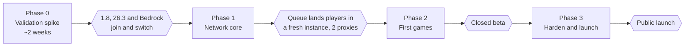

# Roadmap

Four phases, each ending at a gate. Nothing in a phase starts until the gate before it passes. Every task below has a matching issue in its [milestone](https://github.com/xena-studios/hallow/milestones).

## Phase 0: validation spike

Prove the stack before writing games. About two weeks.

- [x] Add Pumpkin, Vine, multiversion and Wings as submodules in `upstream/` at commits that build together
- [ ] Docker Compose for one Vine and two Pumpkin servers with the multiversion plugin
- [ ] `netcheck` smoke test (join through Vine, switch servers) running in CI against the Compose network
- [ ] Test plugin against Pumpkin's WASM API: create a world, load a map, teleport, scoreboard, inventory
- [ ] Run the client version matrix in [Validation](VALIDATION.md)
- [ ] Test server switching through Vine on 1.8.9, 1.12.2 and 26.3
- [ ] Check that Vine's own messages render on old clients
- [ ] Find out how Bedrock clients reach Pumpkin now that it uses NetherNet, then test both routes and pick one
- [ ] Measure how fast Calagopus Wings creates and deletes a server from a template
- [ ] Check what the Calagopus extension API can add: tables, routes, pages
- [ ] Bot load test: players per Pumpkin backend and per Vine
- [ ] Time a Hetzner Cloud node from API call to taking games, and check provider billing terms
- [ ] Ask the Pumpkin team which changes they would take upstream
- [ ] Write the Phase 0 report and update [Decisions](DECISIONS.md) and [Risks](RISKS.md)

**Gate:** a 26.3 and a Bedrock client each join, play and switch servers twice, and the version matrix is filled in. The matrix sets the launch version range (1.8 is a goal, not a gate; see [Decisions](DECISIONS.md) 3).

## Phase 1: network core

- [ ] Vine fork: runtime `register-server` / `unregister-server`, drain mode
- [ ] `crates/proto`: gRPC definitions for the control plane
- [ ] Control plane: server registry, proxy registry, presence in Redis
- [ ] Vine plugins: presence, global ping, duplicate-login check, cross-proxy commands
- [ ] Load balancer with PROXY protocol and health checks
- [ ] Matchmaker: queues, warm instances, start and delete server images through the Wings API
- [ ] Server repos: `hallow.toml` format, server base image, `hallow-server-template`, image build workflow
- [ ] Hallow server plugin: presence, stats and the link to the control plane, in the base image
- [ ] `hub` server repo
- [ ] Parties and friends
- [ ] PostgreSQL schema: accounts, ranks, sessions, punishments
- [ ] Panel fork with Hallow branding and the extension scaffold
- [ ] Panel: Network page and Players page
- [ ] Panel: punishments and staff roles
- [ ] Monitoring: Prometheus, Grafana, Loki
- [ ] Node bootstrap: cloud-init and install script for Docker, Wings, WireGuard and firewall; one-time join tokens

**Gate:** with two proxies running, a player joins the `hub`, queues, the matchmaker starts a fresh instance of a test game repo, and the player lands in it; staff see it all in the panel.

## Phase 2: first games

- [ ] `hallow-sdk`: minigame library (arenas, teams, kits, scoreboards, spectating, stats) for server repos
- [ ] 1.8-style combat module, if [Decisions](DECISIONS.md) keeps it
- [ ] Two launch games (to be chosen), each with its lobby, as server repos
- [ ] Stats, leaderboards and ranks
- [ ] Player website: profiles and leaderboards
- [ ] Panel: reports, games and stats pages
- [ ] Fleet manager: provider trait, scaling rules, drain and cancel, spend caps, dry run
- [ ] Hetzner Cloud provider: burst nodes on demand
- [ ] Scale to one: floor node, per-layer scaling for game instances, lobbies and proxies
- [ ] Budgets: monthly budget, daily cap, forecast, queueing at the cap
- [ ] Panel: Fleet page
- [ ] Closed beta with real players

**Gate:** a closed beta runs a week without data loss or a network-wide outage.

## Phase 3: harden and launch

- [ ] Anticheat (none found for Pumpkin: build or port)
- [ ] Load tests at target size across several proxies and nodes
- [ ] DDoS protection in front of the load balancer
- [ ] Backups and a restore drill for PostgreSQL
- [ ] Runbooks: proxy drain, node loss, upstream update
- [ ] OVHcloud Public Cloud provider
- [ ] Dedicated ordering with approval: Hetzner Robot and OVHcloud dedicated
- [ ] Cross-provider private network and multi-region scaling
- [ ] Public launch

**Gate:** public launch.
