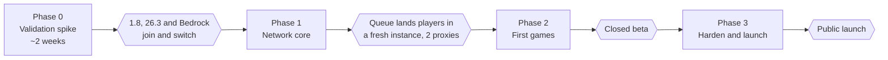

# Roadmap

Four phases, each ending at a gate. Nothing in a phase starts until the gate before it passes. Every task below has a matching issue in its [milestone](https://github.com/xena-studios/hallow/milestones).

## Phase 0: validation spike

Prove the stack before writing games. About two weeks.

- [x] Add Pumpkin, Vine, multiversion and Wings as submodules in `upstream/` at commits that build together
- [x] Docker Compose for one Vine and two Pumpkin servers with the multiversion plugin
- [x] `netcheck` smoke test (join through Vine, switch servers) running in CI against the Compose network
- [x] Test plugin against Pumpkin's WASM API: create a world, load a map, teleport, scoreboard, inventory
- [x] Run the client version matrix in [Validation](VALIDATION.md)
- [x] Test server switching through Vine on 1.8.9, 1.12.2 and 26.3
- [x] Check that Vine's own messages render on old clients
- [x] Find out how Bedrock clients reach Pumpkin now that it uses NetherNet, then test both routes and pick one (Geyser in front of Vine)
- [x] Measure how fast Calagopus Wings creates and deletes a server from a template
- [x] Check what the Calagopus extension API can add: tables, routes, pages
- [x] Bot load test: players per Pumpkin backend and per Vine
- [x] Time a Hetzner Cloud node from API call to taking games, and check provider billing terms (estimated from published measurements; timed for real with the provider in Phase 2)
- [x] Ask the Pumpkin team which changes they would take upstream (asked; answers tracked in [Upstream](UPSTREAM.md))
- [x] Write the Phase 0 report and update [Decisions](DECISIONS.md) and [Risks](RISKS.md)

**Gate: passed 2026-11-14** for 26.3 and Bedrock (bots; real clients confirm in Phase 1). Old versions fail in Vine and move to #66. See the [Phase 0 report](PHASE0.md).

Original gate: a 26.3 and a Bedrock client each join, play and switch servers twice, and the version matrix is filled in. The matrix sets the launch version range (1.8 is a goal, not a gate; see [Decisions](DECISIONS.md) 3).

## Phase 1: network core

- [x] Vine fork: runtime `register-server` / `unregister-server`, drain mode
- [x] Vine fork: plugin scheduler (delayed and repeating tasks), so plugins can heartbeat and poll
- [x] Vine: translate old Java clients on the proxy, using the multiversion plugin's translation as a library (Decisions 29, 33); 1.7.10 to 26.1 bots join, chat, walk and switch twice with no plugin on the servers ([Validation](VALIDATION.md#client-versions))
- [x] `crates/proto`: HTTP/JSON API types for the control plane
- [x] Control plane: server registry, proxy registry, presence in Redis
- [x] Vine plugin: presence, global ping, duplicate-login check, server-list sync
- [x] Vine plugin: cross-proxy commands (`/find`, `/msg` and `/r`, staff `/alert` and `/gkick`); party warp comes with parties
- [x] Load balancer with PROXY protocol and health checks (HAProxy, drain-aware agent checks against the control plane)
- [x] Matchmaker: queues that fill ready game servers, parties kept together
- [x] Matchmaker: warm instances, start and delete server images through the Wings API ([Instances](INSTANCES.md); the gate path runs on the dev network through Docker. The Wings orchestrator has run end to end against a real Wings locally, `tools/wings-e2e`, but not on a cloud or dedicated node yet)
- [x] Server repos: `hallow.toml` format, server base image, `hallow-server-template`, image build workflow (template contents in `templates/server-repo`; the GitHub repo and the first base image tag are still to create)
- [x] Hallow server plugin: the link to the control plane (register, heartbeat, state, unregister), in the base image
- [x] Hallow server plugin: presence (joins, leaves and the full list in heartbeats) and stats (play time, joins, game counters into `hallow.player_stats`)
- [x] `hub` server repo (in-tree as `servers/hub` with its plugin: game menu, `/lobby` and `/hub`, return to the game's lobby; `test-game-lobby` as the first gamemode lobby. Moving it to its own GitHub repo is still to do)
- [x] Parties: invite, accept, leave, kick, disband, warp, chat; parties queue together
- [x] Friends and online status: `/friend`, join and leave notices
- [x] PostgreSQL schema: accounts, ranks, sessions, punishments
- [x] Control plane on PostgreSQL: accounts and sessions at login, bans refuse logins, staff permissions from ranks, `HALLOW_ADMINS` bootstrap
- [x] In-game moderation: `/ban`, `/mute` (with durations), `/unban`, `/unmute`, `/warn`, `/history`, enforced on every proxy
- [x] Panel fork with Hallow branding and the extension scaffold
- [x] Panel: Network page and Players page (network-first admin: Overview landing, Players, Punishments and Anticheat lookups, Fleet section, Hallow theme)
- [x] Panel: punishments and staff roles (issue and lift from the panel, templates, Ranks page, activity log)
- [x] Monitoring: Prometheus, Grafana, Loki (dev stack and dashboard, with each server's tick time from the server plugin)
- [x] Node bootstrap: cloud-init and install script for Docker, Wings, WireGuard and firewall; one-time join tokens (run for real in a container by `tools/wings-e2e`; not yet on a real machine)
- [x] Anticheat signal collection: Vine and the server plugin record timing, movement and combat data to the verdict service ([Anticheat](ANTICHEAT.md)). Both collectors send samples; packet timing waits on a Vine packet hook

**Gate: passed 2026-11-16** on the dev network with bots, and through a real Wings in a container (`tools/wings-e2e`). Real machines, real clients, server repos on GitHub and the Floodgate handoff move to Phase 2. See the [Phase 1 report](PHASE1.md).

Original gate: with two proxies running, a player joins the `hub`, queues, the matchmaker starts a fresh instance of a test game repo, and the player lands in it; staff see it all in the panel.

## Phase 2: first games

Carried from Phase 1 ([report](PHASE1.md#moving-to-phase-2)):

- [ ] Vine: accept Bedrock players from Geyser with their own identity (Floodgate handoff, #72)
- [ ] A blank real machine becomes a node with `deploy/node` (#48), with the Hetzner Cloud provider
- [ ] Server repos on GitHub: `hallow-server-template` and `hub` in their own repos, a published base image tag, `live` and `canary` channels with promote and roll back (#20)
- [ ] Vine packet hook, so the anticheat collector records packet timing (#123)
- [ ] Profile Vine's CPU (crowded lobbies, and many old clients) and send fixes upstream (#124)
- [ ] Real clients: a 26.3 client switching servers, a Bedrock client over NetherNet, old clients for rendering, combat and building; set the launch version range

New in Phase 2:

- [ ] `hallow-sdk`: minigame library (arenas, teams, kits, scoreboards, spectating, stats) for server repos
- [ ] Anticheat core checks (movement, reach, click rate, timer) in observe-only mode, panel review page
- [ ] Cheating bots in `netcheck` (speed, fly, reach, auto-clicker, timer) as a CI suite
- [ ] 1.8-style combat module, if [Decisions](DECISIONS.md) keeps it
- [ ] Two launch games (to be chosen), each with its lobby, as server repos
- [ ] Stats, leaderboards and ranks
- [ ] Player website: profiles and leaderboards
- [ ] Panel: reports, games and stats pages
- [ ] Fleet manager: provider trait, scaling rules, drain and cancel, spend caps, dry run (`crates/fleet` has the trait, the planner and dry run, tested on a simulated day; not yet wired into the control plane, and no audit log yet)
- [ ] Hetzner Cloud provider: burst nodes on demand (`crates/providers/hetzner-cloud`, tested against a mock API; not yet run against Hetzner)
- [ ] Scale to one: floor node, per-layer scaling for game instances, lobbies and proxies
- [ ] Budgets: monthly budget, daily cap, forecast, queueing at the cap (the planner enforces the budget, cap and forecast; panel settings, per-region caps and alerts to come)
- [ ] Panel: Fleet page
- [ ] Closed beta with real players

**Gate:** a closed beta runs a week without data loss or a network-wide outage.

## Phase 3: harden and launch

- [ ] Anticheat actions on: setbacks, kicks, bans with review; thresholds tuned from beta data
- [ ] Load tests at target size across several proxies and nodes
- [ ] DDoS protection in front of the load balancer
- [ ] Backups and a restore drill for PostgreSQL
- [ ] Runbooks: proxy drain, node loss, upstream update
- [ ] OVHcloud Public Cloud provider
- [ ] Dedicated ordering with approval: Hetzner Robot and OVHcloud dedicated
- [ ] Cross-provider private network and multi-region scaling
- [ ] Public launch

**Gate:** public launch.
